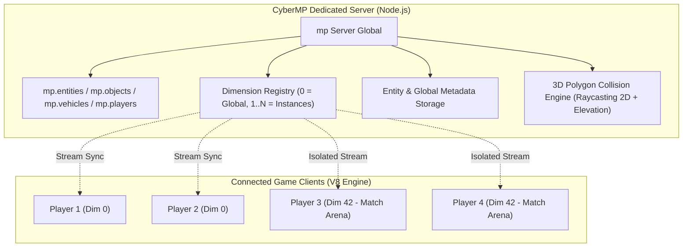
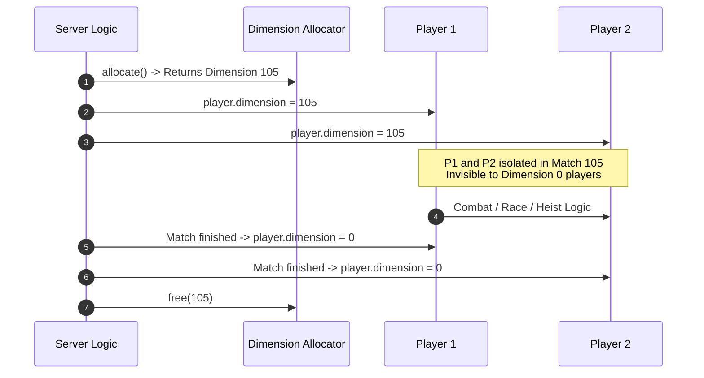

# Server Systems & 3D Math Reference

This reference covers server-side architecture, entity lifecycle management, virtual dimensions, metadata synchronization, player administration, and 3D spatial collision geometry in CyberMP server scripts (`@cybermp/server-types`).

> [!IMPORTANT]
> All code in this reference is procedural and functional TypeScript designed for Node.js execution on the CyberMP dedicated server. It utilizes direct `mp.*` runtime globals without DI containers, decorators, or inversion-of-control frameworks.

---

## Architecture Overview



---

## 1. Server-Side Entity Management

In CyberMP, the server is authoritative over entity lifecycles. Game objects (props, barriers, ramps, interactive items) and vehicles are instantiated using entity pools (`mp.objects` and `mp.vehicles`).

### Object Management (`mp.objects`)

Resolve a prop depot path with `mp.hashes.resref` and pass the result as the model. Verify the asset and its dependencies on the client. [Object spawning](object-spawning-and-streaming.md)

```typescript
import type { MpObject, Vector3, GameHash } from '@cybermp/server-types';

export interface SpawnObjectOptions {
  model: GameHash;
  position: Vector3;
  yaw?: number;
  dynamic?: boolean;
  dimension?: number;
}

/**
 * Spawns a synchronized game object in the server world.
 *
 * @param options Object creation properties
 * @returns The newly created MpObject instance
 */
export function createServerObject(options: SpawnObjectOptions): MpObject {
  const obj = mp.objects.create({
    model: options.model,
    position: options.position,
    yaw: options.yaw ?? 0,
    dynamic: options.dynamic ?? false,
    dimension: options.dimension ?? 0,
  });

  console.log(`[Objects] Created object ID ${obj.id} at [${options.position.join(', ')}] in dimension ${obj.dimension}`);
  return obj;
}

/**
 * Destroys an object by reference or numeric entity ID.
 *
 * @param target The MpObject instance or its numeric entity ID
 */
export function destroyServerObject(target: MpObject | number): void {
  const id = typeof target === 'number' ? target : target.id;
  if (!mp.objects.exists(id)) {
    console.warn(`[Objects] Attempted to destroy nonexistent object ${id}`);
    return;
  }

  mp.objects.destroy(target);
  console.log(`[Objects] Destroyed object ID ${id}`);
}
```

### Vehicle Management (`mp.vehicles`)

Vehicles spawned on the server are automatically replicated to streaming clients in the same dimension.

```typescript
import type { MpVehicle, Vector3, GameHash, CName } from '@cybermp/server-types';
import { VehicleSeat } from '@cybermp/server-types';

export interface SpawnVehicleOptions {
  model: GameHash;
  appearance: CName;
  position: Vector3;
  yaw?: number;
  health?: number;
  dimension?: number;
}

/**
 * Spawns a synchronized server vehicle.
 *
 * @param options Vehicle parameters
 * @returns The instantiated MpVehicle
 */
export function createServerVehicle(options: SpawnVehicleOptions): MpVehicle {
  const vehicle = mp.vehicles.create({
    model: options.model,
    appearance: options.appearance,
    position: options.position,
    yaw: options.yaw ?? 0,
    health: options.health ?? 100,
    dimension: options.dimension ?? 0,
  });

  console.log(`[Vehicles] Created vehicle ID ${vehicle.id} in dimension ${vehicle.dimension}`);
  return vehicle;
}

/**
 * Destroys a server vehicle safely.
 *
 * @param target MpVehicle reference or numeric ID
 */
export function destroyServerVehicle(target: MpVehicle | number): void {
  const id = typeof target === 'number' ? target : target.id;
  if (!mp.vehicles.exists(id)) {
    return;
  }

  mp.vehicles.destroy(target);
  console.log(`[Vehicles] Destroyed vehicle ID ${id}`);
}

/**
 * Inspects all occupants currently seated inside a vehicle.
 */
export function getVehicleOccupants(vehicle: MpVehicle) {
  return {
    driver: vehicle.seats.driver,
    passenger: vehicle.seats.passenger,
    rearLeft: vehicle.seats.rearLeft,
    rearRight: vehicle.seats.rearRight,
    driverBySeat: vehicle.getPlayerInSeat(VehicleSeat.Driver),
  };
}
```

### Entity Lifecycle Pool Manager

To avoid memory leaks from abandoned objects and temporary event props, organize entities in a tracked pool:

```typescript
import type { MpObject, MpVehicle } from '@cybermp/server-types';

export interface EntityPool {
  objects: Map<number, MpObject>;
  vehicles: Map<number, MpVehicle>;
}

export function createEntityPool(): EntityPool {
  return {
    objects: new Map(),
    vehicles: new Map(),
  };
}

export function trackPoolObject(pool: EntityPool, obj: MpObject): MpObject {
  pool.objects.set(obj.id, obj);
  return obj;
}

export function trackPoolVehicle(pool: EntityPool, veh: MpVehicle): MpVehicle {
  pool.vehicles.set(veh.id, veh);
  return veh;
}

/**
 * Cleans up all entities registered in the pool.
 */
export function clearEntityPool(pool: EntityPool): void {
  for (const [id, obj] of pool.objects) {
    if (mp.objects.exists(id)) {
      mp.objects.destroy(obj);
    }
  }
  pool.objects.clear();

  for (const [id, veh] of pool.vehicles) {
    if (mp.vehicles.exists(id)) {
      mp.vehicles.destroy(veh);
    }
  }
  pool.vehicles.clear();

  console.log('[EntityPool] Flushed all registered entities');
}
```

---

## 2. Virtual Dimension Management

Dimensions isolate entities into separate virtual worlds running on the same server instance.

### Core Dimension Rules

The server exposes a writable `dimension` on entities. Use explicit dimension IDs assigned by your mode. Test visibility, interaction and any exceptions in the target build before relying on a special value. When moving an occupied vehicle, coordinate all occupants and the vehicle. [CyberMP entity reference](https://docs.cyber.mp/reference/server/api/entities/mpentity/)

### Isolating Players and Vehicles

```typescript
import type { MpPlayer, MpVehicle } from '@cybermp/server-types';

/**
 * Sets the virtual dimension for a player entity.
 *
 * @param player The target player
 * @param dimension Virtual world ID (0 = global default)
 */
export function setPlayerDimension(player: MpPlayer, dimension: number): void {
  player.dimension = dimension;
  console.log(`[Dimension] Moved player ${player.nickname} (${player.id}) to dimension ${dimension}`);
}

```

### Procedural Dimension Allocator

Use an allocator to lease unique dimension IDs for game modes, minigames, private apartments, and matchmaking lobbies:

```typescript
export interface DimensionAllocator {
  allocate(): number;
  free(dimension: number): void;
  isAllocated(dimension: number): boolean;
  activeCount(): number;
}

export function createDimensionAllocator(startDimension: number = 100): DimensionAllocator {
  let nextId = startDimension;
  const freeList: number[] = [];
  const inUse = new Set<number>();

  return {
    allocate(): number {
      let id: number;
      if (freeList.length > 0) {
        id = freeList.pop()!;
      } else {
        id = nextId++;
      }
      inUse.add(id);
      return id;
    },

    free(dimension: number): void {
      if (!inUse.has(dimension)) {
        return;
      }
      inUse.delete(dimension);
      freeList.push(dimension);
    },

    isAllocated(dimension: number): boolean {
      return inUse.has(dimension);
    },

    activeCount(): number {
      return inUse.size;
    },
  };
}
```

### Instanced Game Mode Workflow



---

## 3. Player Metadata & Administration

CyberMP entities feature metadata key-value stores. Metadata is divided into **server-private** metadata and **network-synchronized** metadata.

### Metadata Mechanics

Use `mp.meta.setPlayerMeta` for explicit synchronization choices. The locked JavaScript declaration also accepts `sync` on entity methods. For values clients must receive, use the metadata manager and verify visibility and lifetime on the target build. Keep permissions on the server and write them only after checking the authenticated account. [CyberMP metadata guide](https://docs.cyber.mp/guides/server/meta/)

```typescript
import type { MpPlayer } from '@cybermp/server-types';

export function setPlayerMetadata(player: MpPlayer, adminLevel: number, clanTag: string): void {
  mp.meta.setPlayerMeta(player, 'account:adminLevel', adminLevel, false);
  mp.meta.setPlayerMeta(player, 'clanTag', clanTag, true);
}
```

### Global Server Metadata

```typescript
/**
 * Sets a synchronized global server announcement or environment state.
 */
export function setServerMaintenanceMode(enabled: boolean): void {
  mp.meta.setGlobalMeta('maintenance_mode', enabled, true);
  console.log(`[Server] Global maintenance mode: ${enabled}`);
}

/**
 * Retrieves global server metadata.
 */
export function isMaintenanceMode(): boolean {
  return mp.meta.getGlobalMeta<boolean>('maintenance_mode') ?? false;
}
```

### Player Administration & Commands

Player administration combines `player.kick`, entity mutations, and command handlers.

```typescript
import type { MpPlayer } from '@cybermp/server-types';

export interface BanRecord {
  ip: string;
  nickname: string;
  reason: string;
  bannedAt: number;
  expiresAt: number | null; // null = permanent
}

export const ActiveBans = new Map<string, BanRecord>();

/**
 * Kicks a player immediately with a logged reason.
 */
export function kickPlayer(player: MpPlayer, reason: string = 'Kicked by administrator'): void {
  console.log(`[Admin] Kicking player ${player.nickname} (${player.id}) for: "${reason}"`);
  player.kick(reason);
}

/**
 * Bans a player by IP and immediately disconnects them.
 */
export function banPlayer(
  player: MpPlayer,
  reason: string,
  durationMinutes: number | null = null,
): void {
  const expiresAt = durationMinutes !== null ? Date.now() + durationMinutes * 60 * 1000 : null;

  ActiveBans.set(player.ip, {
    ip: player.ip,
    nickname: player.nickname,
    reason,
    bannedAt: Date.now(),
    expiresAt,
  });

  kickPlayer(player, `Banned: ${reason}`);
}

/**
 * Validates connecting players against the active ban list using their IP.
 * Called in `playerConnected` where the `player.ip` property is available.
 */
export function checkPlayerBan(ip: string): { banned: boolean; reason?: string } {
  const record = ActiveBans.get(ip);
  if (!record) {
    return { banned: false };
  }

  if (record.expiresAt !== null && Date.now() > record.expiresAt) {
    ActiveBans.delete(ip);
    return { banned: false };
  }

  return { banned: true, reason: record.reason };
}
```

### Admin Commands Registration

Register commands with `mp.commands.add`. The callback receives `(player: MpPlayer | null, args: string[])`. Handle console invocations explicitly, validate inputs and recheck authorization through the server-owned account state. This fragment accepts the resource's authorization function.

```typescript
import type { MpPlayer } from '@cybermp/server-types';

export function registerKickCommand(canKick: (actor: MpPlayer, target: MpPlayer) => boolean): void {
  mp.commands.add('kick', (actor, args) => {
    const [id, ...reason] = args;
    if (!actor || !/^\d+$/.test(id ?? '')) return;
    const targetId = Number(id);
    if (!Number.isSafeInteger(targetId) || !mp.players.exists(targetId)) return;
    const target = mp.players.at(targetId);
    if (canKick(actor, target)) target.kick(reason.join(' ') || 'Kicked by an administrator');
  });
}

mp.events.on('resourceStop', () => mp.commands.remove('kick'));
```

---

## 4. 3D Zones & Polygon Collision

A Safezone needs an ordered polygon footprint, explicit lower and upper Z bounds and an exact dimension. The sample checks player positions when a PvP damage event arrives. Overlapping polygons use union membership. This avoids relying on a delayed UI flag when a player crosses a boundary.

### Authoritative Server Damage Protection (`mp.cancelEvent`)

Freeroam treats the first `damage` argument as the offender and reads the victim from `data.victimId`. The locked declaration calls the first argument `playerId`. The sample handles distinct connected players in the same dimension and calls `mp.cancelEvent()` synchronously. Verify both directions across the boundary in the target build. [Freeroam damage handler](https://github.com/Cyber-MP/CyberMP-Freeroam/blob/main/resources/freeroam/server/src/modules/greenzones/greenzones.service.ts) · [Kit event catalog](events.md)

```typescript env=server checked=@cybermp/server-types@3.2.8
import type { DamageEventData, Vector3 } from '@cybermp/server-types';

type Point2D = readonly [x: number, y: number];

export interface Safezone {
  footprint: readonly Point2D[];
  minZ: number;
  maxZ: number;
  dimension: number;
}

// Use a simple, non-self-intersecting polygon. Edges and vertices are inside.
export function isPointInPolygon2D([x, y]: Point2D, polygon: readonly Point2D[]): boolean {
  if (polygon.length < 3) return false;

  let inside = false;
  for (let i = 0, j = polygon.length - 1; i < polygon.length; j = i++) {
    const [ax, ay] = polygon[j];
    const [bx, by] = polygon[i];
    const dx = bx - ax;
    const dy = by - ay;
    const lengthSquared = dx * dx + dy * dy;
    if (lengthSquared === 0) continue;

    const projection = ((x - ax) * dx + (y - ay) * dy) / lengthSquared;
    if (projection >= 0 && projection <= 1) {
      const edgeDistance = Math.hypot(x - ax - projection * dx, y - ay - projection * dy);
      if (edgeDistance <= 1e-6) return true;
    }

    if ((ay > y) !== (by > y) && x < ax + (y - ay) * dx / dy) inside = !inside;
  }
  return inside;
}

export function isInsideSafezone(position: Vector3, dimension: number, zone: Safezone): boolean {
  const [x, y, z] = position;
  return dimension === zone.dimension && z >= zone.minZ && z <= zone.maxZ
    && isPointInPolygon2D([x, y], zone.footprint);
}

export function registerSafezoneCombatProtection(zones: readonly Safezone[]): () => void {
  const onDamage = (offenderId: number, { victimId }: DamageEventData): void => {
    if (offenderId === victimId || !mp.players.exists(offenderId) || !mp.players.exists(victimId)) return;

    const offender = mp.players.at(offenderId);
    const victim = mp.players.at(victimId);
    if (offender.dimension !== victim.dimension) return;

    const protectedHit = zones.some((zone) =>
      isInsideSafezone(offender.position, offender.dimension, zone)
      || isInsideSafezone(victim.position, victim.dimension, zone),
    );
    if (protectedHit) mp.cancelEvent();
  };
  mp.events.on('damage', onDamage);
  return () => mp.events.off('damage', onDamage);
}
```

Call `registerSafezoneCombatProtection` once with your validated zone configuration and invoke the returned function on `resourceStop`. Keep the geometry separate from any minimap layer. If the mode needs UI enter/leave notifications, compute overall membership across all zones before publishing a change. Clear UI state when the player disconnects or the resource stops.

## 5. Server Resource Lifecycle

Register handlers and validate configuration when the resource starts. Keep ownership of created entities, listeners and timers so the resource can release them on stop. See the [basic server example](../examples/basic-resource/server.ts) and the [event signatures](events.md).

---

## 6. Entity Pools & Array Iteration

CyberMP provides `.toArray()` on entity collections to easily filter, map, and broadcast across active entities:

```typescript
import type { MpPlayer, MpVehicle } from '@cybermp/server-types';

/**
 * Returns all connected players in a specific virtual dimension.
 */
export function getPlayersInDimension(dimension: number): MpPlayer[] {
  return mp.players.toArray().filter((player) => player.dimension === dimension);
}

/**
 * Destroys all vehicles spawned in a specific dimension.
 */
export function cleanupDimensionVehicles(dimension: number): void {
  const vehicles = mp.vehicles.toArray().filter((veh) => veh.dimension === dimension);
  for (const veh of vehicles) {
    veh.destroy();
  }
}

/**
 * Returns total count of all active entities on the dedicated server.
 */
export function getServerEntityCounts(): { players: number; vehicles: number; peds: number; objects: number } {
  return {
    players: mp.players.toArray().length,
    vehicles: mp.vehicles.toArray().length,
    peds: mp.peds.toArray().length,
    objects: mp.objects.toArray().length,
  };
}
```

---

## 7. Player Vehicle References & Limits

`player.vehicle` describes current occupancy. For a spawn limit, track vehicles created by your resource using an explicit account or session owner. Prune stale records and remove only resource-owned vehicles according to the mode's policy. Before despawning, check both ownership and occupancy. [Server vehicle guide](https://docs.cyber.mp/guides/server/vehicles/)

---

## 8. Server-Side String Hashing (`mp.hashes`)

The locked server signatures return `GameHash` (`number | bigint`). Keep the hash kind appropriate to the API. Use `mp.hashes.resref` for prop depot paths.

```typescript
/**
 * Hashes a TweakDB record string on the server.
 * Example: mp.hashes.tweakdbid('Vehicle.v_sport1_herrera_outlaw_player')
 */
export function getTweakdbHash(tweakDbPath: string) {
  return mp.hashes.tweakdbid(tweakDbPath);
}

/**
 * Hashes a REDengine CName string on the server.
 * Example: mp.hashes.cname('player')
 */
export function getCNameHash(name: string) {
  return mp.hashes.cname(name);
}
```

---

## 9. Server Event Cancellation & Network Metrics

### Cancelling Native Damage

Use the [Safezone damage example](#authoritative-server-damage-protection-mpcancelevent) for a synchronous cancellation decision. Verify the event source and resulting health on the target build.

### Checking Player Latency

Each `MpPlayer` instance provides the round-trip ping in milliseconds:

```typescript
import type { MpPlayer } from '@cybermp/server-types';

export function getPlayerPing(player: MpPlayer): number {
  return player.ping;
}
```

### Killfeed & Player Death Tracking (`playerDeath`)

In CyberMP, `playerDeath` triggers on the server with a structured `PlayerDeathEventData` payload:

```typescript
import type { PlayerDeathEventData } from '@cybermp/server-types';

mp.events.on('playerDeath', (victimId: number, { killerId }: PlayerDeathEventData) => {
  const victim = mp.players.exists(victimId) ? mp.players.at(victimId) : undefined;
  const killer = killerId !== undefined && mp.players.exists(killerId)
    ? mp.players.at(killerId) : undefined;

  if (killer) {
    console.log(`[Killfeed] ${killer.nickname} (${killerId}) killed ${victim?.nickname} (${victimId})`);
  } else {
    console.log(`[Killfeed] ${victim?.nickname} (${victimId}) died (no connected killer resolved)`);
  }
});
```

---

## 10. Resource Management & Live Hotreloading (`mp.resources`)

The CyberMP server provides programmatic resource management via `mp.resources`:

```typescript
import { ResourceState } from '@cybermp/server-types';

/**
 * Programmatically restarts a resource without stopping the dedicated server.
 * Used by hotreload watchers and admin commands.
 */
export function restartResource(resourceName: string): void {
  console.log(`[Resources] Restarting resource: ${resourceName}`);
  mp.resources.restart(resourceName);
}

/**
 * Checks whether a given resource is currently running.
 */
export function isResourceRunning(resourceName: string): boolean {
  return mp.resources.getState(resourceName) === ResourceState.Running;
}

/**
 * Safely reads a configuration file from another resource.
 */
export function readResourceConfig(resourceName: string, relativePath: string): string {
  return mp.resources.loadFile(resourceName, relativePath);
}
```

---

## 11. Cross-Resource Exports Pipeline (`mp.exports`)

The public CyberMP guide describes exports within the same runtime. The locked `@cybermp/server-types@3.2.8` declaration has no `MpServer.exports` member. Confirm a server contract and run provider, consumer and restart checks before depending on server exports in TypeScript. Server-local `mp.events.emit` and `mp.events.on` are declared for custom notifications. Verify delivery scope if the listener is in a different resource. For client/server communication use the appropriate network event or RPC. [CyberMP exports guide](https://docs.cyber.mp/guides/resources/exports/) · [Server events guide](https://docs.cyber.mp/guides/server/events/)

---

## 12. In-World Loot Pickups (`mp.pickups`)

The dedicated server can spawn physical weapon and clothing pickups in the world:

```typescript
import { PickupType } from '@cybermp/server-types';
import type { MpPickup, Vector3 } from '@cybermp/server-types';

/**
 * Spawns a loot pickup in the world.
 *
 * @param modelHash REDengine mesh hash
 * @param type Weapon, Clothes, or Other
 * @param position [x, y, z] coordinates
 */
export function spawnLootPickup(
  modelHash: bigint,
  type: PickupType = PickupType.Weapon,
  position: Vector3,
  dimension = 0,
): MpPickup {
  return mp.pickups.create({
    model: modelHash,
    type,
    position,
    yaw: 0,
    dimension,
  });
}
```

---

## 13. Server Config & Runtime Environment (`mp.config` & `mp.isServer`)

Inspect active server runtime parameters from code:

```typescript
/**
 * Validates that current script is executing in the Node.js server context.
 */
export function assertServerRuntime(): void {
  if (!mp.isServer()) {
    throw new Error('This module can only run on the CyberMP dedicated server.');
  }
}

/**
 * Returns server configuration loaded from server.toml.
 */
export function getServerConfig() {
  return {
    maxPlayers: mp.config.max_players,
    tcpHost: mp.config.tcp_host,
    udpHost: mp.config.udp_host,
    activeResources: mp.config.resources,
  };
}
```

---

## 14. Vehicle Seats & Occupants (`vehicle.seats`)

CyberMP provides full tracking of vehicle seating layouts, current occupants, and historic occupants through `vehicle.seats` and `vehicle.lastSeats` on `MpVehicle` instances.

### API Reference (`MpVehicle` Seating)

| Property / Method | Return Type | Description |
|---|---|---|
| `vehicle.seats.driver` | `MpPlayer \| null` | The player currently seated in the driver's seat. |
| `vehicle.seats.passenger` | `MpPlayer \| null` | The player currently seated in the front passenger seat. |
| `vehicle.seats.rearLeft` | `MpPlayer \| null` | The player currently seated in the rear-left seat. |
| `vehicle.seats.rearRight` | `MpPlayer \| null` | The player currently seated in the rear-right seat. |
| `vehicle.lastSeats.driver` | `MpPlayer \| null` | The last player who occupied the driver's seat. |
| `vehicle.lastSeats.passenger` | `MpPlayer \| null` | The last player who occupied the front passenger seat. |
| `vehicle.lastSeats.rearLeft` | `MpPlayer \| null` | The last player who occupied the rear-left seat. |
| `vehicle.lastSeats.rearRight` | `MpPlayer \| null` | The last player who occupied the rear-right seat. |
| `vehicle.getPlayerInSeat(seat)` | `MpPlayer \| null` | Retrieves occupant by `VehicleSeat` enum (`Driver = 0`, `Passenger = 1`, `RearLeft = 2`, `RearRight = 3`). |
| `vehicle.getLastPlayerInSeat(seat)` | `MpPlayer \| null` | Retrieves historic occupant by `VehicleSeat` enum. |

### Vehicle Occupant Inspection & Abandonment Tracking

```typescript
import type { MpVehicle, MpPlayer } from '@cybermp/server-types';
import { VehicleSeat } from '@cybermp/server-types';

/**
 * Returns all players currently seated in a vehicle.
 */
export function getAllOccupants(vehicle: MpVehicle): MpPlayer[] {
  const occupants: MpPlayer[] = [];
  const seats = [
    vehicle.seats.driver,
    vehicle.seats.passenger,
    vehicle.seats.rearLeft,
    vehicle.seats.rearRight,
  ];

  for (const player of seats) {
    if (player && player.exist) {
      occupants.push(player);
    }
  }
  return occupants;
}

/**
 * Identifies the last driver of a vehicle (e.g., for impounding abandoned vehicles).
 */
export function identifyLastDriver(vehicle: MpVehicle): MpPlayer | null {
  // Check active driver first
  if (vehicle.seats.driver) {
    return vehicle.seats.driver;
  }
  // Fall back to historical last occupant
  const lastDriver = vehicle.lastSeats.driver ?? vehicle.getLastPlayerInSeat(VehicleSeat.Driver);
  return lastDriver && lastDriver.exist ? lastDriver : null;
}

/**
 * Sends an application-defined request to passengers. Provide a client handler.
 */
export function requestPassengersExit(vehicle: MpVehicle): void {
  const passengerSeats = [VehicleSeat.Passenger, VehicleSeat.RearLeft, VehicleSeat.RearRight];
  for (const seat of passengerSeats) {
    const occupant = vehicle.getPlayerInSeat(seat);
    if (occupant) {
      occupant.emit('vehicle:eject');
      console.log(`[Vehicles] Requested exit for passenger ${occupant.nickname} from seat ${seat}`);
    }
  }
}
```

---

## 15. Player Voice, Moderation & Physics State

The `MpPlayer` interface provides authoritative controls for voice chat moderation, disconnect handling, physical velocity telemetry, and direct targeted event emission.

### API Reference (`MpPlayer` Voice, Moderation & Physics)

| Member | Signature / Type | Description |
|---|---|---|
| `player.mute()` | `(): void` | Mutes the player's proximity voice chat on the server. |
| `player.kick(reason?)` | `(reason?: string) => void` | Authoritatively disconnects the player instance from the server. |
| `mp.players.kick(target, reason?)` | `(player: MpPlayer \| number, reason?: string) => void` | Global pool helper to kick a player by numeric ID or reference. |
| `player.velocity` | `readonly Vector3` | Current physics velocity vector `[x, y, z]` in meters/second. |
| `player.lastVehicle` | `readonly MpVehicle \| null` | Reference to the vehicle the player most recently occupied. |
| `player.emit(event, ...args)` | `(eventName: string, ...args: any[]) => void` | Emits a client event directly to this player (instance method). |

### Administration & Moderation Recipes

```typescript
import type { MpPlayer } from '@cybermp/server-types';

/**
 * Mutes a player's in-game voice chat and notifies them.
 */
export function mutePlayerVoice(admin: MpPlayer, targetId: number): boolean {
  if (!mp.players.exists(targetId)) {
    admin.emit('chat:system', `Player ID ${targetId} not found.`);
    return false;
  }

  const target = mp.players.at(targetId);
  target.mute(); // Authoritative voice mute
  target.emit('chat:system', 'You have been muted by an administrator.');
  admin.emit('chat:system', `Muted ${target.nickname} (ID: ${targetId}).`);
  console.log(`[Admin] ${admin.nickname} muted ${target.nickname} (${targetId})`);
  return true;
}

/**
 * Kicks a disruptive player using either instance kick or pool kick.
 */
export function kickDisruptivePlayer(targetId: number, reason: string): void {
  if (mp.players.exists(targetId)) {
    const target = mp.players.at(targetId);
    console.log(`[Admin] Kicking ${target.nickname} (${targetId}): ${reason}`);
    // Instance method:
    target.kick(reason);
    // Or equivalently via pool helper:
    // mp.players.kick(targetId, reason);
  }
}

/**
 * Checks player physical velocity for movement anomalies (anti-speedhack / teleports).
 */
export function checkPlayerVelocity(player: MpPlayer, maxAllowedSpeed = 120.0): boolean {
  const [vx, vy, vz] = player.velocity;
  const speed = Math.sqrt(vx * vx + vy * vy + vz * vz);

  if (speed > maxAllowedSpeed && !player.vehicle) {
    console.warn(`[AntiCheat] On-foot velocity anomaly: ${player.nickname} speed=${speed.toFixed(2)} m/s`);
    return false;
  }
  return true;
}

```

---

## 16. Entity Physics Ownership & Synchronization

`MpEntity.owner` is the declared synchronization owner. Verify the observed simulation and migration behavior in the target build. The server can check a candidate owner before assigning it. [CyberMP entity reference](https://docs.cyber.mp/reference/server/api/entities/mpentity/)

### API Reference (`MpEntity` Synchronization)

| Property | Type | Description |
|---|---|---|
| `entity.owner` | `MpPlayer` | Current client authoritative for simulating and streaming physics for this entity. |
| `entity.streamingRadius` | `number` | Distance (in meters) within which clients receive network replication updates. |
| `entity.exist` | `readonly boolean` | `true` if entity instance is valid and alive in the world; `false` once destroyed. |
| `options.dynamic` | `boolean` (optional) | Passed to `mp.objects.create`. Enables physics gravity/collisions when `true`. |

### Physics Host Allocation & Dynamic Object Spawning

```typescript
import type { GameHash, MpPlayer, MpVehicle, MpObject, Vector3 } from '@cybermp/server-types';

/**
 * Spawns a physical dynamic object (reacts to collisions, gravity, impulses).
 * Dynamic objects must have their sync ownership managed when clients join/leave.
 */
export function spawnDynamicProp(
  modelHash: GameHash,
  position: Vector3,
  dimension = 0,
): MpObject {
  const obj = mp.objects.create({
    model: modelHash,
    position,
    yaw: 0,
    dynamic: true, // Rigid-body physics enabled
    dimension,
  });

  // Tune streaming radius for dynamic physics objects (e.g. 100 meters)
  obj.streamingRadius = 100;
  return obj;
}

/**
 * Requests ownership transfer after the resource chooses an eligible player.
 */
export function assignSyncOwner(entity: MpVehicle | MpObject, player: MpPlayer): boolean {
  if (!entity.exist || !player.exist || player.dimension !== entity.dimension) return false;

  const [x, y, z] = entity.position;
  const [px, py, pz] = player.position;
  if (Math.hypot(px - x, py - y, pz - z) > entity.streamingRadius) return false;

  entity.owner = player;
  return true;
}
```

Verify the actual streamed state and active owner before and after transfer. Test owner departure and subsequent movement from both clients. [Vehicle physics](vehicles-physics.md)
