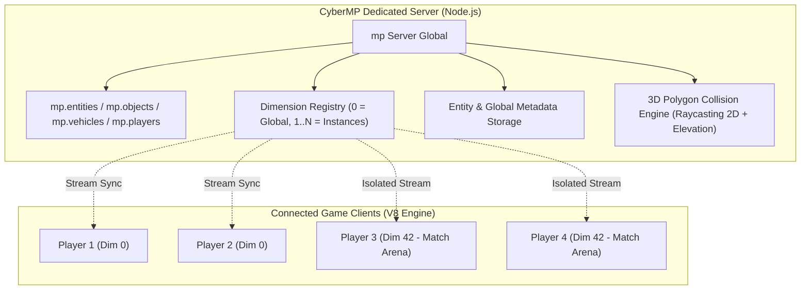
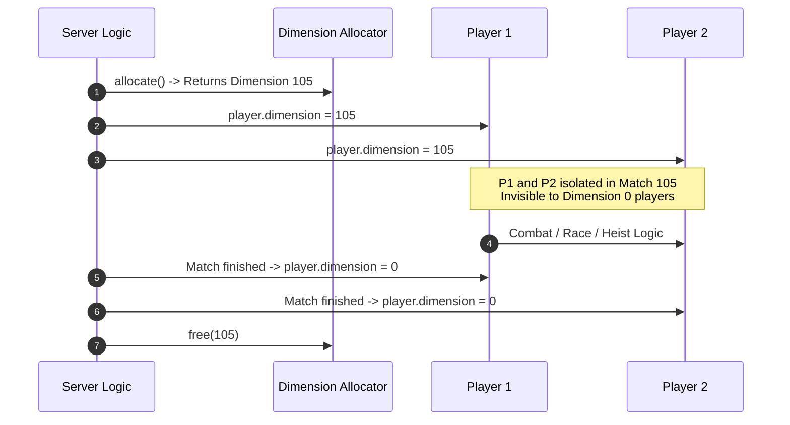

# Server Systems & 3D Math Reference

This reference covers server-side architecture, entity lifecycle management, virtual dimensions, metadata synchronization, player administration, and 3D spatial collision geometry in CyberMP server scripts (`@cybermp/server-types`).

> [!IMPORTANT]
> All code in this reference is procedural and functional TypeScript designed for Node.js execution on the CyberMP dedicated server. It utilizes direct `mp.*` runtime globals without DI containers, decorators, or inversion-of-control frameworks.

---

## Architecture Overview



---

## 1. Server-Side Entity Management

In CyberMP, the server is authoritative over entity lifecycles. Game objects (props, barriers, ramps, interactive items) and vehicles are instantiated using entity pools (`mp.objects` and `mp.vehicles`).

### Object Management (`mp.objects`)

Game objects represent physical REDengine meshes spawned in the multiplayer world. They can be static or dynamic (physics-enabled).

```typescript
import type { MpObject, Vector3, GameHash } from '@cybermp/server-types';

/**
 * Common prop model hashes in REDengine.
 * Game hashes can be represented as 64-bit BigInts or 32-bit numbers.
 */
export const ObjectModelHashes = {
  Radio: 7454566152498118096n,
  TrafficCone: 1045239512398571234n,
  ConcreteBarrier: 8934521098451293845n,
  StreetLight: 3498572394857239485n,
} as const;

export interface SpawnObjectOptions {
  model: GameHash;
  position: Vector3;
  yaw?: number;
  dynamic?: boolean;
  dimension?: number;
}

/**
 * Spawns a synchronized game object in the server world.
 *
 * @param options Object creation properties
 * @returns The newly created MpObject instance
 */
export function createServerObject(options: SpawnObjectOptions): MpObject {
  const obj = mp.objects.create({
    model: options.model,
    position: options.position,
    yaw: options.yaw ?? 0,
    dynamic: options.dynamic ?? false,
    dimension: options.dimension ?? 0,
  });

  console.log(`[Objects] Created object ID ${obj.id} at [${options.position.join(', ')}] in dimension ${obj.dimension}`);
  return obj;
}

/**
 * Destroys an object by reference or numeric entity ID.
 *
 * @param target The MpObject instance or its numeric entity ID
 */
export function destroyServerObject(target: MpObject | number): void {
  const id = typeof target === 'number' ? target : target.id;
  if (!mp.objects.exists(id)) {
    console.warn(`[Objects] Attempted to destroy nonexistent object ${id}`);
    return;
  }

  mp.objects.destroy(target);
  console.log(`[Objects] Destroyed object ID ${id}`);
}
```

### Vehicle Management (`mp.vehicles`)

Vehicles spawned on the server are automatically replicated to streaming clients in the same dimension.

```typescript
import type { MpVehicle, Vector3, GameHash, CName } from '@cybermp/server-types';
import { VehicleSeat } from '@cybermp/server-types';

export interface SpawnVehicleOptions {
  model: GameHash;
  appearance: CName;
  position: Vector3;
  yaw?: number;
  health?: number;
  dimension?: number;
}

/**
 * Spawns a synchronized server vehicle.
 *
 * @param options Vehicle parameters
 * @returns The instantiated MpVehicle
 */
export function createServerVehicle(options: SpawnVehicleOptions): MpVehicle {
  const vehicle = mp.vehicles.create({
    model: options.model,
    appearance: options.appearance,
    position: options.position,
    yaw: options.yaw ?? 0,
    health: options.health ?? 100,
    dimension: options.dimension ?? 0,
  });

  console.log(`[Vehicles] Created vehicle ID ${vehicle.id} in dimension ${vehicle.dimension}`);
  return vehicle;
}

/**
 * Destroys a server vehicle safely.
 *
 * @param target MpVehicle reference or numeric ID
 */
export function destroyServerVehicle(target: MpVehicle | number): void {
  const id = typeof target === 'number' ? target : target.id;
  if (!mp.vehicles.exists(id)) {
    return;
  }

  mp.vehicles.destroy(target);
  console.log(`[Vehicles] Destroyed vehicle ID ${id}`);
}

/**
 * Inspects all occupants currently seated inside a vehicle.
 */
export function getVehicleOccupants(vehicle: MpVehicle) {
  return {
    driver: vehicle.seats.driver,
    passenger: vehicle.seats.passenger,
    rearLeft: vehicle.seats.rearLeft,
    rearRight: vehicle.seats.rearRight,
    driverBySeat: vehicle.getPlayerInSeat(VehicleSeat.Driver),
  };
}
```

### Entity Lifecycle Pool Manager

To avoid memory leaks from abandoned objects and temporary event props, organize entities in a tracked pool:

```typescript
import type { MpObject, MpVehicle } from '@cybermp/server-types';

export interface EntityPool {
  objects: Map<number, MpObject>;
  vehicles: Map<number, MpVehicle>;
}

export function createEntityPool(): EntityPool {
  return {
    objects: new Map(),
    vehicles: new Map(),
  };
}

export function trackPoolObject(pool: EntityPool, obj: MpObject): MpObject {
  pool.objects.set(obj.id, obj);
  return obj;
}

export function trackPoolVehicle(pool: EntityPool, veh: MpVehicle): MpVehicle {
  pool.vehicles.set(veh.id, veh);
  return veh;
}

/**
 * Cleans up all entities registered in the pool.
 */
export function clearEntityPool(pool: EntityPool): void {
  for (const [id, obj] of pool.objects) {
    if (mp.objects.exists(id)) {
      mp.objects.destroy(obj);
    }
  }
  pool.objects.clear();

  for (const [id, veh] of pool.vehicles) {
    if (mp.vehicles.exists(id)) {
      mp.vehicles.destroy(veh);
    }
  }
  pool.vehicles.clear();

  console.log('[EntityPool] Flushed all registered entities');
}
```

---

## 2. Virtual Dimension Management

Dimensions isolate entities into separate virtual worlds running on the same server instance.

### Core Dimension Rules

1. **Dimension `0`**: Default public world. All connected players start here.
2. **Dimension `> 0`**: Private/isolated instances. Entities in dimension `X` can only see, hear, collide with, and interact with other entities in dimension `X`.
3. **Dimension `-1` (Global)**: Entities exist globally across all dimensions (useful for global broadcast markers or universal triggers).
4. Entities across different dimensions are **completely hidden** from each other, drastically reducing network sync bandwidth and client rendering overhead.

### Isolating Players and Vehicles

```typescript
import type { MpPlayer, MpVehicle } from '@cybermp/server-types';

/**
 * Sets the virtual dimension for a player entity.
 *
 * @param player The target player
 * @param dimension Virtual world ID (0 = global default)
 */
export function setPlayerDimension(player: MpPlayer, dimension: number): void {
  player.dimension = dimension;
  console.log(`[Dimension] Moved player ${player.nickname} (${player.id}) to dimension ${dimension}`);
}

/**
 * Moves a player and their current vehicle together into a private dimension.
 *
 * @param player Target player
 * @param dimension Destination dimension
 */
export function transferPlayerAndVehicleToDimension(player: MpPlayer, dimension: number): void {
  player.dimension = dimension;

  if (player.vehicle) {
    player.vehicle.dimension = dimension;
    console.log(`[Dimension] Moved player's vehicle ${player.vehicle.id} to dimension ${dimension}`);
  }
}
```

### Procedural Dimension Allocator

Use an allocator to lease unique dimension IDs for game modes, minigames, private apartments, and matchmaking lobbies:

```typescript
export interface DimensionAllocator {
  allocate(): number;
  free(dimension: number): void;
  isAllocated(dimension: number): boolean;
  activeCount(): number;
}

export function createDimensionAllocator(startDimension: number = 100): DimensionAllocator {
  let nextId = startDimension;
  const freeList: number[] = [];
  const inUse = new Set<number>();

  return {
    allocate(): number {
      let id: number;
      if (freeList.length > 0) {
        id = freeList.pop()!;
      } else {
        id = nextId++;
      }
      inUse.add(id);
      return id;
    },

    free(dimension: number): void {
      if (!inUse.has(dimension)) {
        return;
      }
      inUse.delete(dimension);
      freeList.push(dimension);
    },

    isAllocated(dimension: number): boolean {
      return inUse.has(dimension);
    },

    activeCount(): number {
      return inUse.size;
    },
  };
}
```

### Instanced Game Mode Workflow



---

## 3. Player Metadata & Administration

CyberMP entities feature metadata key-value stores. Metadata is divided into **server-private** metadata and **network-synchronized** metadata.

### Metadata Mechanics

- **`player.setMeta(key, value, sync = false)`**:
  - `sync = false` (default): Private to the server. Useful for DB IDs, auth tokens, cooldowns, sensitive player state.
  - `sync = true`: Broadcast to all streaming clients via the network layer. Automatically accessible on clients.
- **`player.getMeta<T>(key)`**: Reads stored metadata typed as `T`.
- **`mp.meta`**: Global metadata manager for setting server-wide or entity-specific keys.

```typescript
import type { MpPlayer } from '@cybermp/server-types';

export interface PlayerAccountMeta {
  dbId: number;
  adminLevel: number;
  isMuted: boolean;
  joinedAt: number;
}

export interface PlayerPublicMeta {
  clanTag: string;
  isGodMode: boolean;
  isInSafezone: boolean;
}

/**
 * Initializes default metadata upon player authentication.
 */
export function initializePlayerMetadata(player: MpPlayer, account: PlayerAccountMeta): void {
  // 1. Private Server-Side Metadata (sync = false)
  player.setMeta('account:dbId', account.dbId, false);
  player.setMeta('account:adminLevel', account.adminLevel, false);
  player.setMeta('account:isMuted', account.isMuted, false);
  player.setMeta('account:joinedAt', account.joinedAt, false);

  // 2. Synchronized Public Metadata (sync = true -> streamed to connected clients)
  player.setMeta('clanTag', 'ARASAKA', true);
  player.setMeta('isGodMode', false, true);
  player.setMeta('isInSafezone', false, true);
}

/**
 * Verifies if a player has the required administrative permission level.
 */
export function hasAdminLevel(player: MpPlayer, requiredLevel: number): boolean {
  const level = player.getMeta<number>('account:adminLevel') ?? 0;
  return level >= requiredLevel;
}
```

### Global Server Metadata

```typescript
/**
 * Sets a synchronized global server announcement or environment state.
 */
export function setServerMaintenanceMode(enabled: boolean): void {
  mp.meta.setGlobalMeta('maintenance_mode', enabled, true);
  console.log(`[Server] Global maintenance mode: ${enabled}`);
}

/**
 * Retrieves global server metadata.
 */
export function isMaintenanceMode(): boolean {
  return mp.meta.getGlobalMeta<boolean>('maintenance_mode') ?? false;
}
```

### Player Administration & Commands

Player administration combines `player.kick`, entity mutations, and command handlers.

```typescript
import type { MpPlayer } from '@cybermp/server-types';

export interface BanRecord {
  ip: string;
  nickname: string;
  reason: string;
  bannedAt: number;
  expiresAt: number | null; // null = permanent
}

export const ActiveBans = new Map<string, BanRecord>();

/**
 * Kicks a player immediately with a logged reason.
 */
export function kickPlayer(player: MpPlayer, reason: string = 'Kicked by administrator'): void {
  console.log(`[Admin] Kicking player ${player.nickname} (${player.id}) for: "${reason}"`);
  player.kick(reason);
}

/**
 * Bans a player by IP and immediately disconnects them.
 */
export function banPlayer(
  player: MpPlayer,
  reason: string,
  durationMinutes: number | null = null,
): void {
  const expiresAt = durationMinutes !== null ? Date.now() + durationMinutes * 60 * 1000 : null;

  ActiveBans.set(player.ip, {
    ip: player.ip,
    nickname: player.nickname,
    reason,
    bannedAt: Date.now(),
    expiresAt,
  });

  kickPlayer(player, `Banned: ${reason}`);
}

/**
 * Validates connecting players against the active ban list using their IP.
 * Called in `playerConnected` where the `player.ip` property is available.
 */
export function checkPlayerBan(ip: string): { banned: boolean; reason?: string } {
  const record = ActiveBans.get(ip);
  if (!record) {
    return { banned: false };
  }

  if (record.expiresAt !== null && Date.now() > record.expiresAt) {
    ActiveBans.delete(ip);
    return { banned: false };
  }

  return { banned: true, reason: record.reason };
}
```

### Admin Commands Registration

```typescript
import type { MpPlayer } from '@cybermp/server-types';

/**
 * Registers administrative server chat commands.
 * Commands registered via mp.commands.add receive (player: MpPlayer | null, args: string[]).
 */
export function registerAdminCommands(): void {
  // /kick <playerId> <reason...>
  mp.commands.add('kick', (player: MpPlayer | null, args: string[]) => {
    if (!player) return;
    if (!hasAdminLevel(player, 1)) {
      player.emit('chat:notify', 'Permission denied.');
      return;
    }

    const [targetIdStr, ...reasonParts] = args;
    if (!targetIdStr) {
      player.emit('chat:notify', 'Usage: /kick <playerId> <reason>');
      return;
    }

    const targetId = parseInt(targetIdStr, 10);
    if (!mp.players.exists(targetId)) {
      player.emit('chat:notify', `Player ${targetId} not found.`);
      return;
    }
    const target = mp.players.at(targetId);

    const reason = reasonParts.join(' ') || 'Kicked by admin';
    kickPlayer(target, reason);
  });

  // /dimension <dim>
  mp.commands.add('dimension', (player: MpPlayer | null, args: string[]) => {
    if (!player) return;
    if (!hasAdminLevel(player, 2)) {
      player.emit('chat:notify', 'Permission denied.');
      return;
    }

    const dim = args[0] ? parseInt(args[0], 10) : 0;
    player.dimension = dim;
    player.emit('chat:notify', `Switched dimension to ${dim}`);
  });
}
```

---

## 4. 3D Zones & Polygon Collision

CyberMP freeroam resources implement safezones (greenzones) to disable combat, weapon drawing, and vehicle collisions in populated hubs (spawns, clinics, shops).

### 2D Raycasting Algorithm (`isPointInPolygon2D`)

Tests whether a point `(x, y)` lies within an arbitrary non-self-intersecting 2D polygon using the Jordan Curve theorem (even-odd rule):

```typescript
/**
 * Determines whether a 2D coordinate point lies within a polygon using the Raycasting algorithm.
 *
 * @param point Coordinates [x, y] to test
 * @param polygon Ordered array of polygon vertices [[x1, y1], [x2, y2], ...]
 * @returns True if point is inside the polygon boundary
 */
export function isPointInPolygon2D(
  point: [number, number],
  polygon: [number, number][],
): boolean {
  const [x, y] = point;
  let inside = false;

  for (let i = 0, j = polygon.length - 1; i < polygon.length; j = i++) {
    const xi = polygon[i][0];
    const yi = polygon[i][1];
    const xj = polygon[j][0];
    const yj = polygon[j][1];

    // Check intersection with horizontal ray extending to the right
    const intersect =
      yi > y !== yj > y && x < ((xj - xi) * (y - yi)) / (yj - yi) + xi;

    if (intersect) {
      inside = !inside;
    }
  }

  return inside;
}
```

### 3D Safezone Bounding Check (`isInsideSafezone`)

In 3D game engines like Cyberpunk 2077, safezones are extruded vertical prisms defined by:
1. An ordered set of horizontal 2D/3D vertices forming the base footprint.
2. A vertical `height` extrusion parameter.
3. A `dimension` identifier.

```typescript
import type { Vector3 } from '@cybermp/server-types';

/**
 * Checks whether a 3D position collides with an extruded safezone volume.
 *
 * @param position Entity world coordinates [x, y, z]
 * @param vertices Ordered ground boundary vertices [x, y, z]
 * @param height Vertical extrusion height in meters
 * @param dimension Target dimension (-1 matches any dimension)
 * @param currentDimension Entity's current virtual dimension
 * @returns True if the entity is inside the 3D volume
 */
export function isInsideSafezone(
  position: Vector3,
  vertices: Vector3[],
  height: number,
  dimension: number = 0,
  currentDimension: number = 0,
): boolean {
  // 1. Dimension Isolation Check
  if (dimension !== -1 && dimension !== currentDimension) {
    return false;
  }

  // 2. Elevation Range Check (Z-axis bounds with slight margin)
  const minZ = vertices[0][2] - 0.2;
  const maxZ = minZ + height + 0.4;

  if (position[2] < minZ || position[2] > maxZ) {
    return false;
  }

  // 3. 2D Footprint Check (Raycasting on X-Y plane)
  const polygon2D: [number, number][] = vertices.map((v) => [v[0], v[1]]);
  return isPointInPolygon2D([position[0], position[1]], polygon2D);
}
```

### Safezone Manager Implementation

A production-grade, procedural Safezone system that handles periodic spatial collision queries, player enter/leave state transitions, and server damage cancellation:

```typescript
import type { MpPlayer, MpAnyEntity, Vector3, DamageEventData } from '@cybermp/server-types';
import { EntityType } from '@cybermp/server-types';

export interface Safezone {
  id: string;
  name: string;
  vertices: Vector3[];
  height: number;
  dimension: number;
  enabled: boolean;
  occupants: Set<number>; // Entity IDs inside zone
  debugObjects: Set<number>;
}

export interface SafezoneManager {
  zones: Map<string, Safezone>;
  createZone(opts: {
    id: string;
    name: string;
    vertices: Vector3[];
    height: number;
    dimension?: number;
    enabled?: boolean;
    debugVisuals?: boolean;
  }): Safezone;
  removeZone(id: string): void;
  startTick(intervalMs?: number): () => void;
  isPlayerInAnySafezone(player: MpPlayer): boolean;
}

const DEBUG_CORNER_PROP_HASH = 7454566152498118096n; // Radio or marker prop

/**
 * Creates and initializes a procedural Safezone Manager.
 */
export function createSafezoneManager(): SafezoneManager {
  const zones = new Map<string, Safezone>();

  function spawnDebugVisuals(zone: Safezone): void {
    for (const v of zone.vertices) {
      // Bottom corner marker
      const bottomObj = mp.objects.create({
        model: DEBUG_CORNER_PROP_HASH,
        position: v,
        dimension: Math.max(0, zone.dimension),
      });
      zone.debugObjects.add(bottomObj.id);

      // Top corner marker
      const topObj = mp.objects.create({
        model: DEBUG_CORNER_PROP_HASH,
        position: [v[0], v[1], v[2] + zone.height],
        dimension: Math.max(0, zone.dimension),
      });
      zone.debugObjects.add(topObj.id);
    }
  }

  function destroyDebugVisuals(zone: Safezone): void {
    for (const objId of zone.debugObjects) {
      if (mp.objects.exists(objId)) {
        mp.objects.destroy(objId);
      }
    }
    zone.debugObjects.clear();
  }

  function handleEntityEnter(zone: Safezone, entity: MpAnyEntity): void {
    zone.occupants.add(entity.id);

    if (entity.type === EntityType.Player) {
      const player = entity as MpPlayer;
      player.setMeta('isInSafezone', true, true);

      // Notify player via chat or RPC
      player.emit('safezone:enter', zone.name);
      console.log(`[Safezone] Player ${player.nickname} entered "${zone.name}"`);
    }
  }

  function handleEntityLeave(zone: Safezone, entity: MpAnyEntity): void {
    zone.occupants.delete(entity.id);

    if (entity.type === EntityType.Player) {
      const player = entity as MpPlayer;
      player.setMeta('isInSafezone', false, true);

      player.emit('safezone:leave', zone.name);
      console.log(`[Safezone] Player ${player.nickname} exited "${zone.name}"`);
    }
  }

  const manager: SafezoneManager = {
    zones,

    createZone(opts) {
      const zone: Safezone = {
        id: opts.id,
        name: opts.name,
        vertices: opts.vertices,
        height: opts.height,
        dimension: opts.dimension ?? 0,
        enabled: opts.enabled ?? true,
        occupants: new Set(),
        debugObjects: new Set(),
      };

      if (opts.debugVisuals) {
        spawnDebugVisuals(zone);
      }

      zones.set(zone.id, zone);
      return zone;
    },

    removeZone(id: string) {
      const zone = zones.get(id);
      if (!zone) return;

      destroyDebugVisuals(zone);
      zone.occupants.clear();
      zones.delete(id);
    },

    startTick(intervalMs = 100) {
      const intervalId = setInterval(() => {
        if (zones.size === 0) return;

        const players = mp.players.toArray();

        for (const zone of zones.values()) {
          if (!zone.enabled) continue;

          for (const player of players) {
            const isColliding = isInsideSafezone(
              player.position,
              zone.vertices,
              zone.height,
              zone.dimension,
              player.dimension,
            );
            const isContained = zone.occupants.has(player.id);

            if (!isContained && isColliding) {
              handleEntityEnter(zone, player);
            } else if (isContained && !isColliding) {
              handleEntityLeave(zone, player);
            }
          }
        }
      }, intervalMs);

      // Return cleanup function
      return () => {
        clearInterval(intervalId);
        for (const zone of zones.values()) {
          destroyDebugVisuals(zone);
        }
      };
    },

    isPlayerInAnySafezone(player: MpPlayer): boolean {
      for (const zone of zones.values()) {
        if (zone.enabled && zone.occupants.has(player.id)) {
          return true;
        }
      }
      return false;
    },
  };

  return manager;
}
```

### Authoritative Server Damage Protection

In CyberMP, player damage events are authoritative on the server. Listen to the `damage` event and cancel it if the victim or attacker is in a safezone:

```typescript
import type { SafezoneManager } from './safezone-manager';
import type { DamageEventData } from '@cybermp/server-types';

/**
 * Registers authoritative server-side combat protection for safezones.
 * The damage callback receives (offenderId: number, data: DamageEventData),
 * where offenderId is the attacker and data.victimId is the targeted victim.
 */
export function registerSafezoneCombatProtection(manager: SafezoneManager): void {
  mp.events.on('damage', (offenderId: number, data: DamageEventData) => {
    const offender = mp.players.exists(offenderId) ? mp.players.at(offenderId) : null;
    const victim = data.victimId && mp.players.exists(data.victimId) ? mp.players.at(data.victimId) : null;

    // Check if either victim or attacker is protected inside a safezone
    const victimInZone = victim ? manager.isPlayerInAnySafezone(victim) : false;
    const attackerInZone = offender ? manager.isPlayerInAnySafezone(offender) : false;

    if (victimInZone || attackerInZone) {
      // mp.cancelEvent() cancels the native damage event on the server
      mp.cancelEvent();
      console.log(`[Safezone] Blocked combat damage between offender ${offenderId} and victim ${data.victimId}`);
    }
  });
}
```

### Helper: Generating Square/Box Safezones

```typescript
import type { Vector3 } from '@cybermp/server-types';

/**
 * Creates 4 boundary vertices for an axis-aligned square safezone footprint.
 *
 * @param centerX Center world X coordinate
 * @param centerY Center world Y coordinate
 * @param groundZ Ground elevation Z
 * @param size Width and length of the square zone in meters
 * @returns Array of 4 Vector3 vertices [BottomLeft, BottomRight, TopRight, TopLeft]
 */
export function createSquareSafezoneVertices(
  centerX: number,
  centerY: number,
  groundZ: number,
  size: number,
): Vector3[] {
  const half = size / 2;
  return [
    [centerX - half, centerY - half, groundZ], // Bottom Left
    [centerX + half, centerY - half, groundZ], // Bottom Right
    [centerX + half, centerY + half, groundZ], // Top Right
    [centerX - half, centerY + half, groundZ], // Top Left
  ];
}
```

---

## 5. Clean Server Module Template

Here is a ready-to-run server script wiring entity pools, dimensions, admin commands, and safezones:

```typescript
import type { MpPlayer } from '@cybermp/server-types';
import {
  createSafezoneManager,
  createSquareSafezoneVertices,
  registerSafezoneCombatProtection,
} from './safezone-mechanics';
import { createDimensionAllocator } from './dimension-allocator';
import { registerAdminCommands, checkPlayerBan } from './admin-mechanics';

// 1. Initialize Allocators & Managers
const dimensions = createDimensionAllocator(100);
const safezones = createSafezoneManager();

// 2. Setup Default Spawn Safezone (Afterlife Hub)
const spawnVertices = createSquareSafezoneVertices(-1412.5, 1285.2, 23.4, 40);
safezones.createZone({
  id: 'afterlife_spawn',
  name: 'Afterlife Safezone',
  vertices: spawnVertices,
  height: 15.0,
  dimension: 0,
  debugVisuals: process.env.NODE_ENV === 'development',
});

// 3. Start Zone Tick Loop and Combat Cancellation
const stopZones = safezones.startTick(100);
registerSafezoneCombatProtection(safezones);
registerAdminCommands();

// 4. Connection & Lifecycle Guards
// playerConnecting provides (tempId: number, name: string)
mp.events.on('playerConnecting', (tempId: number, name: string) => {
  console.log(`[Server] Player connecting: ${name} (tempId: ${tempId})`);
});

// playerConnected provides (playerId: number, tempId: string)
// Player IP address (player.ip) is available once the player entity is instantiated
mp.events.on('playerConnected', (playerId: number, tempId: string) => {
  if (!mp.players.exists(playerId)) return;
  const player = mp.players.at(playerId);

  // Validate player IP against ban list upon connection
  const banStatus = checkPlayerBan(player.ip);
  if (banStatus.banned) {
    console.log(`[Security] Kicking banned IP ${player.ip} (${banStatus.reason})`);
    player.kick(`Your IP address is permanently banned: ${banStatus.reason}`);
    return;
  }

  player.dimension = 0;
  player.setMeta('account:joinedAt', Date.now(), false);
  console.log(`[Server] Player ${player.nickname} (${playerId}) initialized in default dimension`);
});

// 5. Clean Resource Shutdown
mp.events.on('resourceStop', () => {
  stopZones();
  console.log('[Server] Safezones and resources stopped cleanly');
});
```

---

## 6. Entity Pools & Array Iteration

CyberMP provides `.toArray()` on entity collections to easily filter, map, and broadcast across active entities:

```typescript
import type { MpPlayer, MpVehicle } from '@cybermp/server-types';

/**
 * Returns all connected players in a specific virtual dimension.
 */
export function getPlayersInDimension(dimension: number): MpPlayer[] {
  return mp.players.toArray().filter((player) => player.dimension === dimension);
}

/**
 * Destroys all vehicles spawned in a specific dimension.
 */
export function cleanupDimensionVehicles(dimension: number): void {
  const vehicles = mp.vehicles.toArray().filter((veh) => veh.dimension === dimension);
  for (const veh of vehicles) {
    veh.destroy();
  }
}

/**
 * Returns total count of all active entities on the dedicated server.
 */
export function getServerEntityCounts(): { players: number; vehicles: number; peds: number; objects: number } {
  return {
    players: mp.players.toArray().length,
    vehicles: mp.vehicles.toArray().length,
    peds: mp.peds.toArray().length,
    objects: mp.objects.toArray().length,
  };
}
```

---

## 7. Player Vehicle References & Limits

When a player enters a vehicle, the server entity exposes `player.vehicle`. You can track and enforce maximum vehicles per player:

```typescript
import type { MpPlayer, MpVehicle, GameHash } from '@cybermp/server-types';

const playerVehiclesMap = new Map<number, Set<number>>();
const MAX_VEHICLES_PER_PLAYER = 3;

/**
 * Spawns a vehicle for a player and tracks vehicle count.
 */
export function spawnPlayerVehicle(
  player: MpPlayer,
  modelHash: GameHash,
  appearanceHash: GameHash = 0n,
): MpVehicle {
  // If player is already inside a vehicle, despawn it first
  if (player.vehicle) {
    player.vehicle.destroy();
  }

  const vehicle = mp.vehicles.create({
    model: modelHash,
    appearance: appearanceHash,
    position: player.position,
    yaw: player.yaw,
    dimension: player.dimension,
    health: 2000,
  });

  const vehicles = playerVehiclesMap.get(player.id) ?? new Set<number>();
  while (vehicles.size >= MAX_VEHICLES_PER_PLAYER) {
    const oldestId = vehicles.values().next().value;
    if (oldestId !== undefined) {
      mp.vehicles.destroy(oldestId);
      vehicles.delete(oldestId);
    }
  }

  vehicles.add(vehicle.id);
  playerVehiclesMap.set(player.id, vehicles);
  return vehicle;
}
```

---

## 8. Server-Side String Hashing (`mp.hashes`)

The server runtime provides `mp.hashes.tweakdbid` and `mp.hashes.cname` to convert string names to 64-bit BigInt hashes:

```typescript
/**
 * Hashes a TweakDB record string on the server.
 * Example: mp.hashes.tweakdbid('Vehicle.v_sport1_herrera_outlaw_player')
 */
export function getTweakdbHash(tweakDbPath: string): bigint {
  return mp.hashes.tweakdbid(tweakDbPath);
}

/**
 * Hashes a REDengine CName string on the server.
 * Example: mp.hashes.cname('player')
 */
export function getCNameHash(name: string): bigint {
  return mp.hashes.cname(name);
}
```

---

## 9. Server Event Cancellation & Network Metrics

### Cancelling Native Damage

To implement invincible players or safezones, call `mp.cancelEvent()` inside the `damage` event listener:

```typescript
import type { DamageEventData } from '@cybermp/server-types';

const godModePlayers = new Set<number>();

mp.events.on('damage', (_offenderId: number, { victimId }: DamageEventData) => {
  if (victimId && godModePlayers.has(victimId)) {
    // mp.cancelEvent() prevents damage calculation and health pool decrease
    mp.cancelEvent();
  }
});
```

### Checking Player Latency

Each `MpPlayer` instance provides the round-trip ping in milliseconds:

```typescript
export function getPlayerPing(player: MpPlayer): number {
  return player.ping;
}
```

### Killfeed & Player Death Tracking (`playerDeath`)

In CyberMP, `playerDeath` triggers on the server with a structured `PlayerDeathEventData` payload:

```typescript
import type { PlayerDeathEventData } from '@cybermp/server-types';

mp.events.on('playerDeath', (victimId: number, { killerId }: PlayerDeathEventData) => {
  const victim = mp.players.at(victimId);
  const killer = killerId !== undefined ? mp.players.at(killerId) : undefined;

  if (killer) {
    console.log(`[Killfeed] ${killer.nickname} (${killerId}) killed ${victim?.nickname} (${victimId})`);
  } else {
    console.log(`[Killfeed] ${victim?.nickname} (${victimId}) died of natural causes or suicide`);
  }
});
```

---

## 10. Resource Management & Live Hotreloading (`mp.resources`)

The CyberMP server provides programmatic resource management via `mp.resources`:

```typescript
import { ResourceState } from '@cybermp/server-types';

/**
 * Programmatically restarts a resource without stopping the dedicated server.
 * Used by hotreload watchers and admin commands.
 */
export function restartResource(resourceName: string): void {
  console.log(`[Resources] Restarting resource: ${resourceName}`);
  mp.resources.restart(resourceName);
}

/**
 * Checks whether a given resource is currently running.
 */
export function isResourceRunning(resourceName: string): boolean {
  return mp.resources.getState(resourceName) === ResourceState.Running;
}

/**
 * Safely reads a configuration file from another resource.
 */
export function readResourceConfig(resourceName: string, relativePath: string): string {
  return mp.resources.loadFile(resourceName, relativePath);
}
```

---

## 11. Cross-Resource Exports Pipeline (`mp.exports`)

CyberMP supports sharing functions across resources without circular imports or bundling dependencies:

```typescript
// 1. In provider resource (e.g. 'auth'):
mp.exports('isPlayerAdmin', (playerId: number): boolean => {
  const player = mp.players.at(playerId);
  return player?.getMeta('admin') === true;
});

// 2. In consumer resource (e.g. 'freeroam'):
export function checkRemoteAdmin(playerId: number): boolean {
  // Access exported function through mp.exports.<resourceName>.<functionName>
  return mp.exports.auth.isPlayerAdmin(playerId);
}
```

---

## 12. In-World Loot Pickups (`mp.pickups`)

The dedicated server can spawn physical weapon and clothing pickups in the world:

```typescript
import { PickupType } from '@cybermp/server-types';
import type { MpPickup, Vector3 } from '@cybermp/server-types';

/**
 * Spawns a loot pickup in the world.
 *
 * @param modelHash REDengine mesh hash
 * @param type Weapon, Clothes, or Other
 * @param position [x, y, z] coordinates
 */
export function spawnLootPickup(
  modelHash: bigint,
  type: PickupType = PickupType.Weapon,
  position: Vector3,
  dimension = 0,
): MpPickup {
  return mp.pickups.create({
    model: modelHash,
    type,
    position,
    yaw: 0,
    dimension,
  });
}
```

---

## 13. Server Config & Runtime Environment (`mp.config` & `mp.isServer`)

Inspect active server runtime parameters from code:

```typescript
/**
 * Validates that current script is executing in the Node.js server context.
 */
export function assertServerRuntime(): void {
  if (!mp.isServer()) {
    throw new Error('This module can only run on the CyberMP dedicated server.');
  }
}

/**
 * Returns server configuration loaded from server.toml.
 */
export function getServerConfig() {
  return {
    maxPlayers: mp.config.max_players,
    tcpHost: mp.config.tcp_host,
    udpHost: mp.config.udp_host,
    activeResources: mp.config.resources,
  };
}
```

---

## 14. Vehicle Seats & Occupants (`vehicle.seats`)

CyberMP provides full tracking of vehicle seating layouts, current occupants, and historic occupants through `vehicle.seats` and `vehicle.lastSeats` on `MpVehicle` instances.

### API Reference (`MpVehicle` Seating)

| Property / Method | Return Type | Description |
|---|---|---|
| `vehicle.seats.driver` | `MpPlayer \| null` | The player currently seated in the driver's seat. |
| `vehicle.seats.passenger` | `MpPlayer \| null` | The player currently seated in the front passenger seat. |
| `vehicle.seats.rearLeft` | `MpPlayer \| null` | The player currently seated in the rear-left seat. |
| `vehicle.seats.rearRight` | `MpPlayer \| null` | The player currently seated in the rear-right seat. |
| `vehicle.lastSeats.driver` | `MpPlayer \| null` | The last player who occupied the driver's seat. |
| `vehicle.lastSeats.passenger` | `MpPlayer \| null` | The last player who occupied the front passenger seat. |
| `vehicle.lastSeats.rearLeft` | `MpPlayer \| null` | The last player who occupied the rear-left seat. |
| `vehicle.lastSeats.rearRight` | `MpPlayer \| null` | The last player who occupied the rear-right seat. |
| `vehicle.getPlayerInSeat(seat)` | `MpPlayer \| null` | Retrieves occupant by `VehicleSeat` enum (`Driver = 0`, `Passenger = 1`, `RearLeft = 2`, `RearRight = 3`). |
| `vehicle.getLastPlayerInSeat(seat)` | `MpPlayer \| null` | Retrieves historic occupant by `VehicleSeat` enum. |

### Vehicle Occupant Inspection & Abandonment Tracking

```typescript
import type { MpVehicle, MpPlayer } from '@cybermp/server-types';
import { VehicleSeat } from '@cybermp/server-types';

/**
 * Returns all players currently seated in a vehicle.
 */
export function getAllOccupants(vehicle: MpVehicle): MpPlayer[] {
  const occupants: MpPlayer[] = [];
  const seats = [
    vehicle.seats.driver,
    vehicle.seats.passenger,
    vehicle.seats.rearLeft,
    vehicle.seats.rearRight,
  ];

  for (const player of seats) {
    if (player && player.exist) {
      occupants.push(player);
    }
  }
  return occupants;
}

/**
 * Identifies the last driver of a vehicle (e.g., for impounding abandoned vehicles).
 */
export function identifyLastDriver(vehicle: MpVehicle): MpPlayer | null {
  // Check active driver first
  if (vehicle.seats.driver) {
    return vehicle.seats.driver;
  }
  // Fall back to historical last occupant
  const lastDriver = vehicle.lastSeats.driver ?? vehicle.getLastPlayerInSeat(VehicleSeat.Driver);
  return lastDriver && lastDriver.exist ? lastDriver : null;
}

/**
 * Ejects all passengers from a vehicle, keeping the driver.
 */
export function ejectPassengers(vehicle: MpVehicle): void {
  const passengerSeats = [VehicleSeat.Passenger, VehicleSeat.RearLeft, VehicleSeat.RearRight];
  for (const seat of passengerSeats) {
    const occupant = vehicle.getPlayerInSeat(seat);
    if (occupant) {
      occupant.emit('vehicle:eject');
      console.log(`[Vehicles] Ejected passenger ${occupant.nickname} from seat ${seat}`);
    }
  }
}
```

---

## 15. Player Voice, Moderation & Physics State

The `MpPlayer` interface provides authoritative controls for voice chat moderation, disconnect handling, physical velocity telemetry, and direct targeted event emission.

### API Reference (`MpPlayer` Voice, Moderation & Physics)

| Member | Signature / Type | Description |
|---|---|---|
| `player.mute()` | `(): void` | Mutes the player's proximity voice chat on the server. |
| `player.kick(reason?)` | `(reason?: string) => void` | Authoritatively disconnects the player instance from the server. |
| `mp.players.kick(target, reason?)` | `(player: MpPlayer \| number, reason?: string) => void` | Global pool helper to kick a player by numeric ID or reference. |
| `player.velocity` | `readonly Vector3` | Current physics velocity vector `[x, y, z]` in meters/second. |
| `player.lastVehicle` | `readonly MpVehicle \| null` | Reference to the vehicle the player most recently occupied. |
| `player.emit(event, ...args)` | `(eventName: string, ...args: any[]) => void` | Emits a client event directly to this player (instance method). |

### Administration & Moderation Recipes

```typescript
import type { MpPlayer } from '@cybermp/server-types';

/**
 * Mutes a player's in-game voice chat and notifies them.
 */
export function mutePlayerVoice(admin: MpPlayer, targetId: number): boolean {
  if (!mp.players.exists(targetId)) {
    admin.emit('chat:system', `Player ID ${targetId} not found.`);
    return false;
  }

  const target = mp.players.at(targetId);
  target.mute(); // Authoritative voice mute
  target.emit('chat:system', 'You have been muted by an administrator.');
  admin.emit('chat:system', `Muted ${target.nickname} (ID: ${targetId}).`);
  console.log(`[Admin] ${admin.nickname} muted ${target.nickname} (${targetId})`);
  return true;
}

/**
 * Kicks a disruptive player using either instance kick or pool kick.
 */
export function kickDisruptivePlayer(targetId: number, reason: string): void {
  if (mp.players.exists(targetId)) {
    const target = mp.players.at(targetId);
    console.log(`[Admin] Kicking ${target.nickname} (${targetId}): ${reason}`);
    // Instance method:
    target.kick(reason);
    // Or equivalently via pool helper:
    // mp.players.kick(targetId, reason);
  }
}

/**
 * Checks player physical velocity for movement anomalies (anti-speedhack / teleports).
 */
export function checkPlayerVelocity(player: MpPlayer, maxAllowedSpeed = 120.0): boolean {
  const [vx, vy, vz] = player.velocity;
  const speed = Math.sqrt(vx * vx + vy * vy + vz * vz);

  if (speed > maxAllowedSpeed && !player.vehicle) {
    console.warn(`[AntiCheat] On-foot velocity anomaly: ${player.nickname} speed=${speed.toFixed(2)} m/s`);
    return false;
  }
  return true;
}

/**
 * Recalls the player's last occupied vehicle back to their current position.
 */
export function recallLastVehicle(player: MpPlayer): boolean {
  const lastVeh = player.lastVehicle;
  if (!lastVeh || !lastVeh.exist) {
    player.emit('chat:system', 'You do not have an active recent vehicle.');
    return false;
  }

  // Teleport vehicle to player position
  console.log(`[Vehicles] Recalling vehicle ${lastVeh.id} to player ${player.nickname}`);
  player.emit('chat:system', `Vehicle ${lastVeh.id} recalled.`);
  return true;
}
```

---

## 16. Entity Physics Ownership & Synchronization

In CyberMP's multiplayer network topology, physics calculations for dynamic objects and vehicles are host-synchronized: the server designates a connected client as the **physics owner** (sync host) who computes local simulation and streams transformation frames to peers.

### API Reference (`MpEntity` Synchronization)

| Property | Type | Description |
|---|---|---|
| `entity.owner` | `MpPlayer` | Current client authoritative for simulating and streaming physics for this entity. |
| `entity.streamingRadius` | `number` | Distance (in meters) within which clients receive network replication updates. |
| `entity.exist` | `readonly boolean` | `true` if entity instance is valid and alive in the world; `false` once destroyed. |
| `options.dynamic` | `boolean` (optional) | Passed to `mp.objects.create`. Enables physics gravity/collisions when `true`. |

### Physics Host Allocation & Dynamic Object Spawning

```typescript
import type { MpPlayer, MpVehicle, MpObject, Vector3 } from '@cybermp/server-types';

/**
 * Spawns a physical dynamic object (reacts to collisions, gravity, impulses).
 * Dynamic objects must have their sync ownership managed when clients join/leave.
 */
export function spawnDynamicProp(
  modelHash: bigint,
  position: Vector3,
  dimension = 0,
): MpObject {
  const obj = mp.objects.create({
    model: modelHash,
    position,
    yaw: 0,
    dynamic: true, // Rigid-body physics enabled
    dimension,
  });

  // Tune streaming radius for dynamic physics objects (e.g. 100 meters)
  obj.streamingRadius = 100;
  return obj;
}

/**
 * Reassigns sync ownership of an entity to the closest available player.
 * Ensures smooth physics simulation when the previous host moves away or disconnects.
 */
export function migrateSyncOwnership(entity: MpVehicle | MpObject): boolean {
  if (!entity.exist) {
    return false;
  }

  const [ex, ey, ez] = entity.position;
  let closestPlayer: MpPlayer | null = null;
  let minDistanceSq = Infinity;

  for (const player of mp.players.toArray()) {
    if (player.dimension !== entity.dimension) continue;

    const [px, py, pz] = player.position;
    const distSq = (px - ex) ** 2 + (py - ey) ** 2 + (pz - ez) ** 2;

    if (distSq < minDistanceSq) {
      minDistanceSq = distSq;
      closestPlayer = player;
    }
  }

  if (closestPlayer) {
    entity.owner = closestPlayer; // Assign sync host
    console.log(`[Sync] Assigned entity ${entity.id} sync ownership to ${closestPlayer.nickname}`);
    return true;
  }

  return false;
}
```
